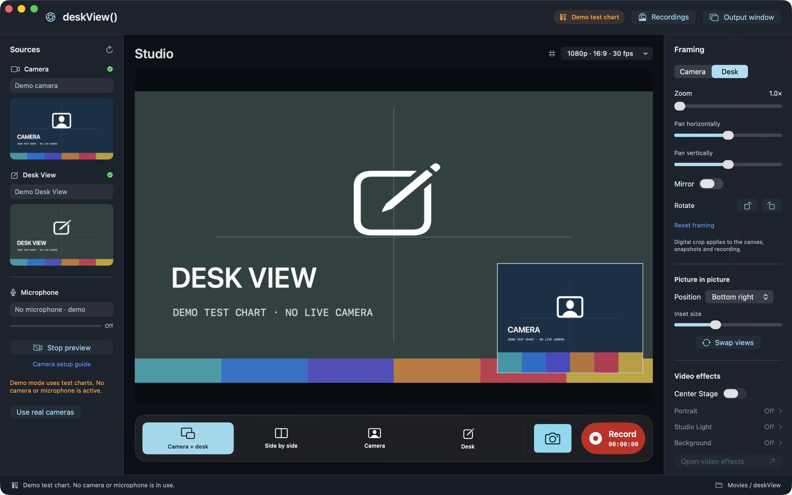

<div align="center">

# deskView()

**Your camera. Your desk. One little studio.**

A native SwiftUI and Liquid Glass camera studio for Apple Silicon Macs.
Record your iPhone's Continuity Camera and overhead Desk View together.

A [Belweave](https://github.com/Belweave) project. First-launch welcome powered by [FoyerKit](https://github.com/Belweave/FoyerKit).

</div>



## The studio

- **Two sources, one canvas.** Discover Continuity Camera, built-in and external cameras, and paired Desk View devices.
- **Four layouts.** Camera + desk picture in picture, side by side, camera only, or desk only. Portrait output stacks the two views vertically.
- **Frame each source.** Digital crop zoom, horizontal/vertical pan, mirroring and 90° rotation. Move and resize the inset, or swap the background.
- **Record what you see.** The same Core Image compositor drives the preview, PNG snapshots and H.264 `.mov` recording, with optional AAC microphone audio.
- **Choose your output.** 720p, 1080p or 4K canvas; 16:9, 9:16 or square; 24 or 30 fps. Source detail and frame rate depend on the connected device. 4K output may upscale a lower-resolution source.
- **Use macOS effects.** Center Stage where supported, status for Portrait/Studio Light/background replacement, the system video-effects panel, microphone modes and available reaction effects.
- **Share a clean view.** Open the separate Output window and select it in your call app's screen-sharing picker.
- **Keep everything local.** Choose a save folder, browse recordings and snapshots, open them, or reveal them in Finder. No account, analytics, server, or network capture.
- **Native welcome.** FoyerKit onboarding with skip, replay, VoiceOver and system accessibility adaptations.

## Requirements

- Apple Silicon Mac running **macOS 26 or later**.
- **Xcode 27.1 RC (27A9275)**, or a newer stable Xcode, for the local build. Swift 6.3+ is required by FoyerKit.
- Apple's **Metal toolchain** for FoyerKit's shaders. If needed: `xcodebuild -downloadComponent MetalToolchain`.
- Camera permission; microphone permission only when a microphone is selected.
- A compatible source for Desk View. Apple's current list includes eligible iPhones through Continuity Camera and certain recent Macs/displays. See [Apple's Desk View requirements](https://support.apple.com/en-us/121541).

Continuity Camera requires the same Apple Account with two-factor authentication and an eligible iPhone. See [Apple's setup guide](https://support.apple.com/en-us/102546). The app discovers the cameras macOS makes available; it does not pair or unlock an iPhone itself.

## Build and run

```sh
git clone https://github.com/Belweave/deskView.git
cd deskView
./scripts/run.sh
```

Or open `DeskView.xcodeproj`, select the **deskView** scheme and **My Mac**, then Run. The committed project needs no generator or third-party build tool. FoyerKit is pinned to a reviewed commit; Xcode resolves it through Swift Package Manager.

Build storage stays on disk under `.build/`. Builds use two jobs by default; set `DESKVIEW_JOBS=1` through `4` to change the bound.

```sh
./scripts/build.sh Release
./scripts/test.sh
./scripts/run.sh --demo --skip-intro
```

Demo mode uses explicitly labeled test charts and no camera or microphone. It can produce sample movies and snapshots without physical capture hardware.

Local builds are ad-hoc signed. Developer ID signing, notarization and App Store distribution require the maintainer's Apple credentials and are not configured by this source checkout. The manual **Package app** workflow creates a development ZIP artifact, not a notarized release.

## First recording

1. Mount your locked iPhone near the Mac, or attach it with a trusted USB cable. Enable Continuity Camera in iPhone Settings → General → AirPlay & Continuity.
2. Refresh Sources, choose your camera and its paired Desk View, then **Start preview**. Allow camera and optional microphone access.
3. Choose a layout. Select **Camera** or **Desk** in Framing and adjust that source. The framing grid is a preview aid and is not recorded.
4. Select output dimensions and microphone, then press **Record** (`⌘R`). Press it again to stop and finish saving.
5. Open **Recordings** (`⇧⌘L`) to play the movie or reveal it in Finder. Snapshots use `⇧⌘S`.

The default destination is `~/Movies/deskView/`. Settings lets you choose another folder. Output settings and source changes are locked during recording. If a required camera stops sending frames, the app finishes the available portion and reports the interruption.

## Scope and verification

This app uses public AVFoundation APIs. macOS owns camera hardware effects, lens selection and Continuity Camera availability. Digital framing affects the composed canvas. The Output window is shared using screen sharing; this version does not install a virtual-camera extension or replace another app's camera selector.

Automated tests verify composition pixels, framing transformations, missing sources, PNG dimensions, empty recordings and real video/audio encoding. Physical Continuity Camera/Desk View behavior requires compatible connected devices and OS permission; see [TESTING.md](TESTING.md) for the hardware checklist and actual verification status.

## Development

- [Architecture](ARCHITECTURE.md)
- [Testing](TESTING.md)
- [Initial release verification](Documentation/Verification.md)
- [Product brief](PRODUCT.md)
- [Design system](DESIGN.md)
- [Contributing](CONTRIBUTING.md)
- [Project instructions](AGENTS.md)
- [Changelog](CHANGELOG.md)

The app is in `App/`. Capture, composition and recording live in the standalone `DeskViewKit` Swift package under `Sources/`. After adding or removing app source files, run `python3 scripts/generate-project.py` to regenerate the deterministic Xcode project. The icon source is `scripts/make-icon.swift`.

## License

[MIT](LICENSE). FoyerKit is Apache 2.0; its license and notices accompany development app packages. See [THIRD_PARTY_NOTICES.md](THIRD_PARTY_NOTICES.md).
